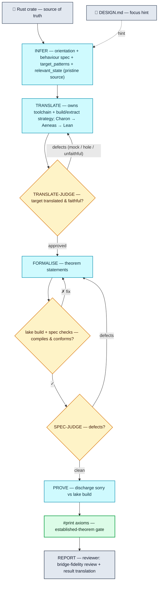

# Pipeline



Each stage runs with a fresh AI-agent session (fresh context — the judge's context is
independent of the author's); stages communicate via git-committed files under `/workspace/out`,
not via message history.

| Stage | Deliverable (files) | Harness gate |
|---|---|---|
| INFER | `infer/campaigns/<Campaign>.json` (`entry_file` + properties + `target_patterns` + `relevant_state`) | valid JSON with `target_patterns` |
| TRANSLATE | `lean/<Crate>.lean` + `translate/{plan,accountability}.md` | compiles · target is a real `def` (not opaqued/holed) · single top-level module |
| TRANSLATE-JUDGE | `translate/verdict.json` | empty defect list (semantic screen; independent session) |
| FORMALISE | `lean/<Crate>/Spec.lean` (statements, bodies `:= by sorry`) | `lake build` compiles · mechanical spec checks conform (`check_spec_gate`) |
| SPEC-JUDGE | `spec/verdict.json` | empty defect list |
| PROVE | proofs + supporting lemmas committed into the Lean library; any theorem that is false as stated → refuted in `Refutations.lean` + `prove/refutations.json` | `#print axioms` — three-way: established / modulo trusted base / tainted; a refutation is kernel-checked by `verify_refutations` |
| REPORT | `report/campaigns/<Campaign>/NN_*.md` — an audience-facing review centred on the bridge-fidelity review (`04_fidelity.md`) | — (harness prepends the authoritative verdict, incl. the projection-grounding rung) |

FORMALISE writes statements (bodies `:= by sorry`) and PROVE proves them, but nothing needs to
*force* that split: `collectAxioms` classifies every theorem by its real kernel axioms whoever wrote
the proof, so a FORMALISE-authored proof is simply judged — genuine ones count, `sorryAx`-resting ones
are tainted. The axiom gate after PROVE is the authoritative verdict; the report's headline metric —
generated by the harness, not the agent — is the number of established theorems that also *run* an
Aeneas-translated function and constrain its result. A theorem that merely names a translated type or
value constant (running no function) is split into its own weaker bucket, not folded into the headline.

The verdict carries a further **grounding** rung: for each measurement the spec *projects* (e.g. reading
`.val` fields into `Int`/`Nat` rather than phrasing a property through the real, fallible call), the
harness re-runs the anchor check over the *established* set and records whether a theorem that HOLDS
ties that projection back to the real function — an unbridged projection is flagged, not hidden (a
bridge left `sorry` while its invariants are clean is exactly the gap this closes). REPORT is then the
**reviewer**: it turns that verdict into an account a Rust engineer can check, centred on a
per-projection *fidelity review* (`04_fidelity.md` — does each projected quantity provably mirror the
real code), with the failure modes surfaced as loudly as the guarantees.

## Mechanical spec checks — the shape gate on the spec

The compile gate above only proves the spec *builds*. It says nothing about whether each theorem is
worth proving. The classic way a spec quietly cheats is a theorem that **assumes the very thing it
claims to prove**:

```lean
theorem t (s s' : State) (h : transfer s = ok s') (h2 : s'.total = s.total) : s'.total = s.total
```

This compiles, is genuinely provable (the proof is just `exact h2`), and `#print axioms` calls it
clean — yet it holds for almost *any* implementation, because the fact it "proves" was handed to it
as a hypothesis (`h2`). A plain text search over the Lean source can't catch this: it can't tell that
`s'` is an *output* of `transfer` while `s` is an *input* — and that distinction is the whole point.
Sorting it out requires Lean to first resolve the notation, the hidden arguments, and the automatic
conversions.

**So the harness ships a tiny Lean program that reads what a theorem actually *means*.**

### How it works — reading the "elaborated" form

When Lean processes a theorem, it turns the surface syntax you type into a fully worked-out internal
form — the **elaborated type**: every bit of notation expanded, every hidden argument and conversion
filled in, every name resolved to the exact thing it refers to. Lean lets you write small programs
that walk this form, in a language called **MetaM**. That is all the checker is: a MetaM program that
asks a handful of structural questions about each theorem's elaborated type and prints one
machine-readable verdict line per theorem.

The harness copies that program (`checks/spec_checks.lean`) into each crate's Lean tree, builds it
next to the spec, and runs it over the compiled theorems (`lean.check_spec_gate`). A finding is a
hard rejection: FORMALISE gets back a critique naming the theorem, the check, and the rule it broke,
fixes it, and resubmits. Because the program reads the *meaning* and not the text, it sees straight
through renaming and shorthand that a regex never could — including into predicates a theorem borrows
from another module (a prior campaign's spec, or a helper module PROVE wrote), which a source scan
can't follow at all.

### Why this is safe: every theorem says what kind it is

A blind shape rule would reject honest work — some real properties (injectivity, determinism)
genuinely *do* need hypotheses about outputs. So FORMALISE labels every theorem with one of two
families:

- `@[lusterna]` — a **checked property**: a weakest-precondition *triple* over one of the target
  operations, `op args ⦃ r => <claim about r> ⦄`, making a claim about the result the operation
  produced (a postcondition, or a property preserved across the call);
- `@[lusterna_lemma "why"]` — a supporting lemma deliberately outside that shape (a relational
  property, a bridge, a pure arithmetic helper), with a stated reason.

The gate checks that the label is *honest* — that a `@[lusterna]` theorem really has the checked
shape — and `@[lusterna_lemma]` puts the genuinely-relational properties out of scope by declaration.
A finding on a theorem that claimed to be checked is thus a fact about its own claim, which is what
lets it block. One thing to note about the vocabulary: whether a *preserved* property is, across the
whole campaign, an **invariant** of the system is a conclusion the PROVE stage reaches (a base case
plus a preservation for every operation) — it is never a label on a single theorem. The gate checks
properties; invariance is proved. And the one thing the gate can't judge — whether a theorem *means*
the right thing — is exactly what SPEC-JUDGE looks at next.

### The check

**The theorem is a triple over a target, and its claim can't cheat** (`schema_conformance`). A checked
property is an Aeneas WP triple `op args ⦃ r => post r ⦄`: the operation runs *once*, and the triple
asserts it *terminates without failing* — so the property can never be satisfied by a call that
reverted, the result `r` is bound freshly (nothing can pin it), and there is no execution hypothesis
through which to smuggle a fact. That single form does for free everything a separate shape rule and
information-flow analysis used to police by hand. All the gate then vets is the postcondition, which
must:

- **mention the result `r`** — or it says nothing about what the operation produced;
- **be a plain proposition** — ordinary integer arithmetic over the projected fields, naming no nested
  *fallible measurement* of the result. This is the **fail-safe** rule, the subtle one: a measurement
  inside the claim can fail (an overflow, a missing key), and if it quietly makes the claim true on
  that failure, the theorem holds for free on states nobody meant to allow. State the property on the
  raw integer fields, or bridge the measurement in a lemma;
- **genuinely constrain `r`** — not a tautology that assumes itself, not `True`.

This is the one thing safe to *default to rejecting*, precisely because it only ever runs against a
family the author chose (applied to arbitrary theorems it would flag every honest use of
"and"/"or"/"implies").

Three **governance** rules keep the checked family from being quietly emptied — the failure that once
let a campaign pass with *zero* checked theorems, every core property demoted to a lemma. A measurement
the properties reason about must be referenced by some theorem (a bridge), and by a *checked* one; and
systemically, if no theorem is a checked triple over any target at all, the gate hard-stops rather than
reporting "clean". What the gate cannot establish is whether the theorem *means* the right thing —
whether a plain-integer projection faithfully mirrors the real code, whether the property is the one
that matters — so that judgment of fitness (versus form) stays with SPEC-JUDGE.

`tests/checklean/` is the regression suite for the gate: a fixture crate of theorems that must
fire and controls that must not (including the accepted misses), run
against the real toolchain by `python tests/checklean/verify.py`, which drives the checker through
the exact same invocation the harness uses in a real run. Cases the check deliberately *skips* are
pinned there too, so "clean" can never quietly mean "never ran".

The same "read the meaning, not the text" idea runs through the rest of the harness: the
established-vs-tainted verdict is `collectAxioms` (the kernel's own axiom trace), and the
report's "verifies the implementation" tally is another MetaM check (`checkImplReference`) that asks
whether a theorem's statement actually runs a translated *function* — distinguishing that from merely
naming a translated type or value constant — robust to the `open`s and namespaces that a text search
trips over.

## TRANSLATE

TRANSLATE is where the target Rust becomes Lean. The session drives Charon and Aeneas at the shell,
scoping to the target's functions (`--start-from`) and getting the target's own logic translated as
real Lean `def`s. Aeneas has a limited Rust fragment, so on larger targets some dependencies do not
translate. The session handles each by the least-degrading option that works:

- **scope** — `--start-from` the target's call-closure and drop out-of-closure noise;
- **assume** — `--opaque` a trusted leaf dependency the properties do not reason about (crypto,
  hashing, transcripts, formatting); Aeneas emits it as a Lean `axiom`, which the `#print axioms`
  gate then flags on any theorem that depends on it;
- **model** — a behaviour-preserving source refactor when a data structure the properties *do*
  depend on has no Lean model (e.g. a `BTreeMap` ledger → an association list); confirmed against the
  crate's own `cargo test` and recorded, with the diff, in `translate/accountability.md`.

The translation is then held to three things, in order — two mechanical gates and one semantic judge:

1. **Compile gate** — `lake build` accepts it (a single top-level module, no split files).
2. **The taint gate** (`lean.target_footprint_gate`, the `checkDefAxioms` MetaM check) — a **hard,
   fail-closed** gate: no target function may transitively rest on an opaque axiom. It runs
   `collectAxioms` — the *same* closure the PROVE `#print axioms` gate takes — over each target `def`
   at translate time, so a leak is caught in seconds rather than after a $100 PROVE. Because that
   closure covers a function's whole body (error, panic, and formatting branches included), it catches
   an opaque leaf reached through a "harmless" path — a modelled type whose `Display`/`serde` was
   delegated back to the opaque original, a `Pubkey` field that rode along in a struct, a
   `native_decide` helper — every one of which would taint every downstream theorem. A *clean*
   translation (the sanctioned design — substrate modelled as real defs, irrelevant surface dropped)
   has an **empty** target footprint; a non-empty one blocks the round with a categorised, actionable
   critique (drop the formatting surface, project the field away, replace the `native_decide`). It
   fails **closed**: a build/driver failure, or zero targets matched (the false-clean a name mismatch
   produces), blocks — silence is never "clean".
3. **TRANSLATE-JUDGE** (a separate, independent session) — the *semantic* screen the machine cannot
   do. It rejects a translation that mocks the target (`target_mocked`/`holes_in_target`), under-models
   a property-bearing dependency (`over_opaqued`), changes observable behaviour (`semantics_changed`/
   `not_faithful`), or — the relevance check — **keeps surface outside the minimal core**
   (`irrelevant_surface`). "Irrelevant" is not a free judgement: INFER declares `relevant_state`, the
   exact struct fields and value-types the properties constrain, and anything modelled or kept outside
   it — a field no property reads, a modelled `Display`/serde, a heavyweight helper for something
   unused — must be dropped, *even though it compiles and is taint-clean*. The taint gate owns
   soundness (goals not tainted); the judge owns minimality (no garbage in), against INFER's declared
   core.

If the target cannot be translated without mocking it, the run aborts rather than emitting a hollow
translation.

To make the session recognise-and-apply rather than rediscover Aeneas's fragment every run, the
translatability playbook (`docs/skills/aeneas-translate.md`) is appended to the TRANSLATE briefing —
how to identify what Aeneas opaqued, holed, or rejected (by reading the generated Lean, and when in
doubt Aeneas's own builtin registry in the container), the behaviour-preserving recipe for each, and
the charon/aeneas mechanics. It teaches the agent to read the live toolchain rather than a snapshot,
so nothing goes stale across the nightly Aeneas bumps.

## PROVE

PROVE discharges the `sorry`-bodied statements, and like every other labor stage it is *not*
refereed by the harness. It runs one budgeted, resumable agent session — the per-stage
`--max-budget-usd` is the hard stop — and the agent drives an ordinary, cumulative Lean development:
proving supporting lemmas, giving the translated functions and their loops the `@[progress]` spec
lemmas a bottom-up proof needs, and committing as it goes. Git is both the persistence and the
safety net (a session that leaves the build red falls back to its own last green commit); `#print
axioms` over the committed library is the sole arbiter. There is no scoring, stall-detection, or
rollback logic in the harness — that machinery constrained the agent against the grain of how proofs
are actually built, and it is gone.

A hard obligation can bottom out in a fact that is *true but intractable to prove at this modelling
altitude* — typically the value semantics of a low-level primitive the translation reproduced
bit-for-bit (e.g. a multi-limb fixed-point multiply-divide whose faithful Lean model is a
256-iteration restoring-division loop). For these the agent may declare a **trusted assumption**: a
general `axiom` in a dedicated `lean/<Crate>/Assumptions.lean` stating the primitive's value
contract, and then prove the rest *modulo* it. The trust is disclosed, never hidden — `#print
axioms` still reports the dependency — so the verdict is three-way rather than binary:

- **established** — the proof rests only on the standard axioms (`propext` / `Classical.choice` /
  `Quot.sound`);
- **established modulo the trusted base** — rests only on those plus declared assumptions (each
  listed with the theorems that use it);
- **not established** — a leftover `sorry` or a non-standard axiom; verifies nothing.

This is the proof-time analogue of TRANSLATE's `--opaque` (assume an untranslatable *leaf*): here we
assume an *unprovable substrate fact*, disclosed the same way. And it is bounded by the same
principle that keeps the whole harness honest — it can never launder a goal into the trusted base. A
declared assumption may reference **only the substrate, never a target function under verification**
(the harness checks each assumption's statement against the INFER `target_patterns`; an assumption
that mentions a target is refused and any theorem leaning on it is demoted to *tainted*). Since a
goal states a property *of* a target, no goal can be admitted as an assumption — if it cannot be
proved it stays an honest `sorry`. The assumptions are general and reusable across campaigns, and can
later be *discharged* — proved against a value model — to retire the trust entirely.

### Counterexamples — when a property is *false*

Sometimes the sustained effort to prove a theorem instead surfaces a **counterexample**: the property
simply does not hold for the code as written (a classic case is an unguarded arithmetic overflow the
statement forgot to exclude). This is not a failure — finding it is the most valuable thing the
pipeline can produce. Rather than leave an unprovable `sorry`, PROVE *refutes* the theorem: it proves
the negation as a `<name>__refuted` lemma in a dedicated `lean/<Crate>/Refutations.lean` (a concrete
counterexample, so `decide` / `native_decide` is admissible here) and records it in
`prove/refutations.json`. The harness verifies the refutation mechanically — the dual of the proof
gate — with two checks: a **type tie** (`example : False := <name>__refuted <name>` type-checks, so
the refutation targets the *exact* statement, not a strawman) and **purity** (`#print axioms` clean of
`sorryAx`). A refutation passing both is surfaced as a **headline finding** in the verdict and report:
a kernel-verified discrepancy warranting investigation. The prover never edits the statement to make
the counterexample vanish (statements are FORMALISE's, and the spec was already independently judged
by SPEC-JUDGE), and a refutation is a *falsehood* — it can never enter `Assumptions.lean`, the
trusted-*true* ledger. It is reported, not papered over.